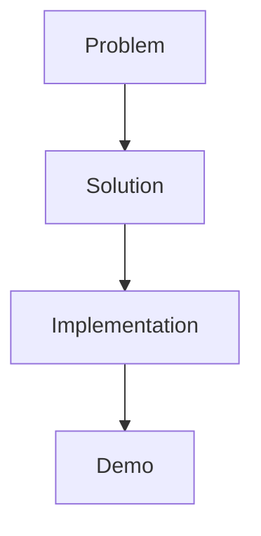

# Hackathon Project - Développement & Collaboration


Projet réalisé dans le cadre d’un **hackathon**, avec un objectif de conception rapide d’une solution technique répondant à une problématique donnée.

---

## Résumé exécutif

Participation à un hackathon avec conception et réalisation d’un projet en temps limité, impliquant **analyse du besoin**, **développement rapide** et **présentation d’une solution fonctionnelle**.

Objectif : démontrer la capacité à **travailler sous contrainte**, **collaborer** et produire un résultat exploitable dans un délai court.

---

## Contexte

Le projet s’inscrit dans un environnement de hackathon avec :

* temps limité
* contraintes techniques
* travail en équipe (ou solo selon le cas)
* objectif de démonstration rapide

---

## Réalisations clés

* Analyse rapide du besoin et définition de la solution
* Conception d’un prototype fonctionnel
* Développement en temps contraint
* Organisation du travail et priorisation
* Présentation finale du projet

---

## Approche technique

Selon le contenu du PDF :

* Conception de la solution
* Implémentation rapide
* Tests fonctionnels
* Validation du prototype

---

## Architecture (conceptuelle)



---

## Compétences démontrées

* Travail sous contrainte temporelle
* Résolution de problèmes
* Esprit d’analyse
* Développement rapide (prototypage)
* Organisation et priorisation
* Communication technique

---

## Limites

* Projet réalisé en temps limité
* Prototype (non industrialisé)
* Fonctionnalités potentiellement incomplètes

---

## Perspectives d’amélioration

* Industrialisation du projet
* Ajout de fonctionnalités
* Amélioration de la sécurité
* Optimisation des performances

---

## Valeur professionnelle

Ce projet démontre la capacité à :

* S’adapter rapidement à un problème technique
* Travailler efficacement sous pression
* Produire un prototype fonctionnel
* Collaborer dans un contexte dynamique

---

## Structure du projet

```text
.
├── hackathon.pdf
└── README.md
```

---

## Documentation

Le fichier `hackathon.pdf` contient :

* le sujet
* la solution proposée
* les étapes de réalisation

---

## Auteur

Alexis Noiret
Étudiant en cybersécurité
